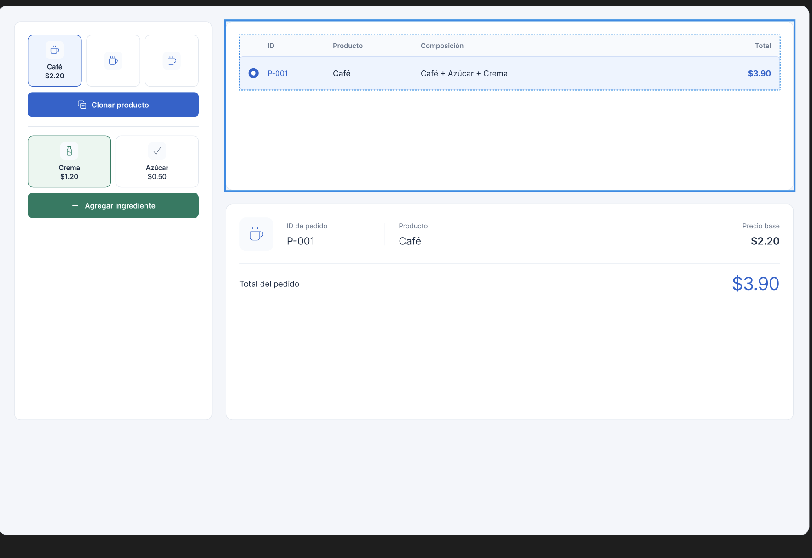
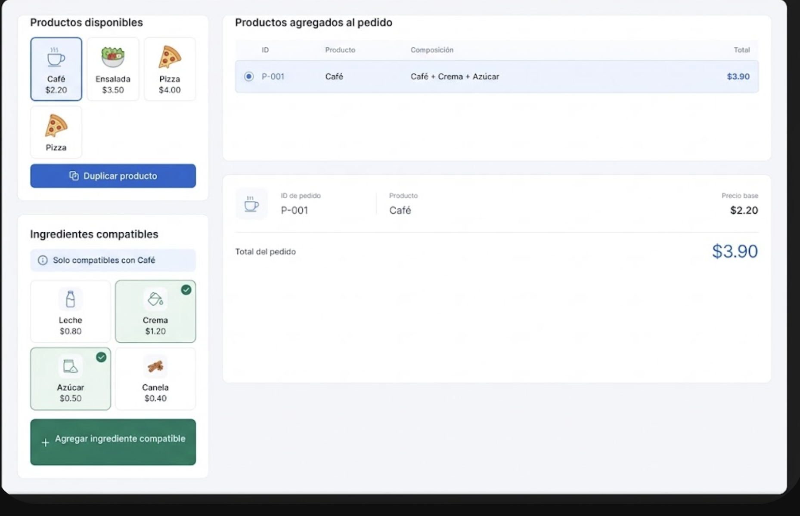

# **Creacion del mockup**
## `Creacion personal en figma`
 Se realizo el prototipo del mockup en Figma que nos recomendo el ingeniero se uso como guia el mockup que se nos dio en las indicaciones con un cambio en que haya botones para seleccionar los diferentes productos en lugar de una lista.

## `Mejora realizada por Gemini`
Se envio el mockup realizado al asistente Gemini para que mejore el diseño este fue el resultado

## `Diagrama UML sobre las relaciones de la clases`

Tenemos el diagrama UML en donde se observa las diferentes relaciones entre clases
