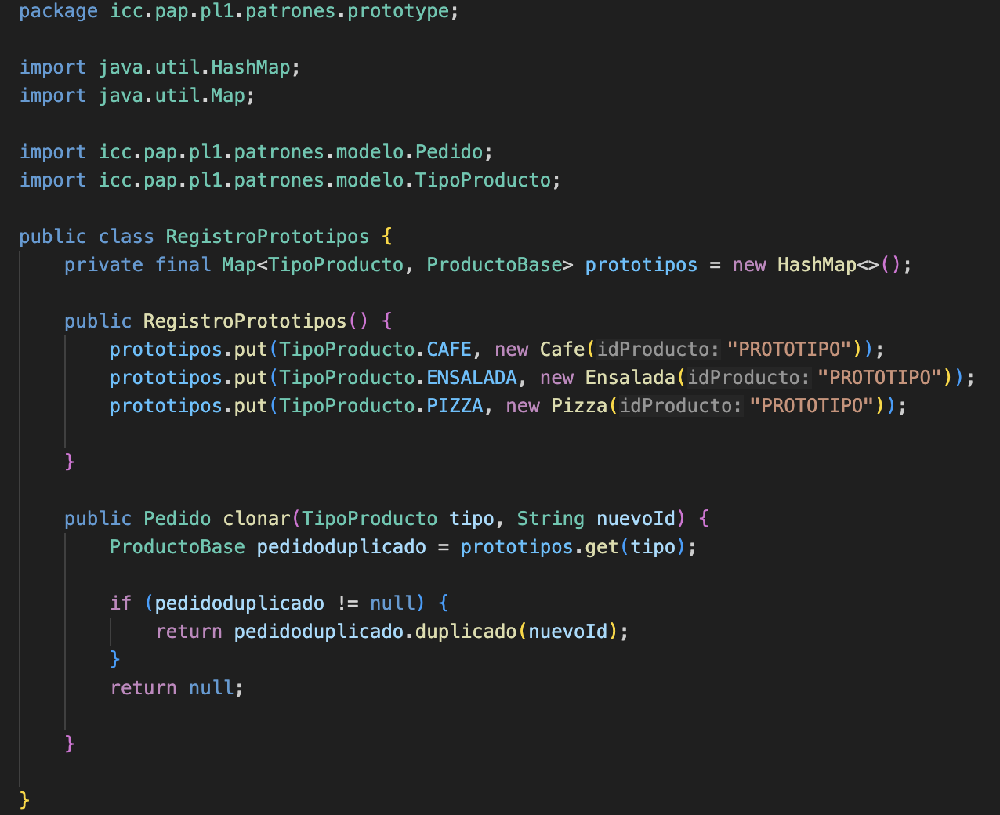
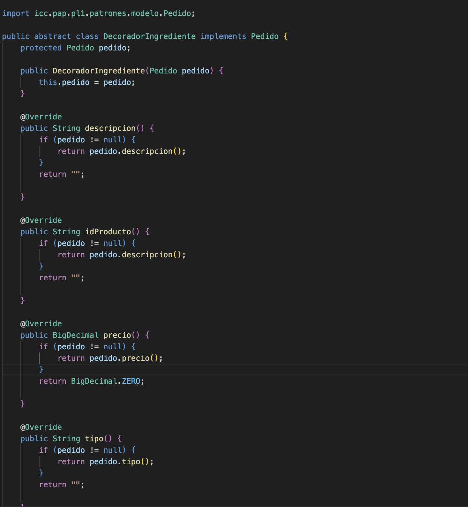
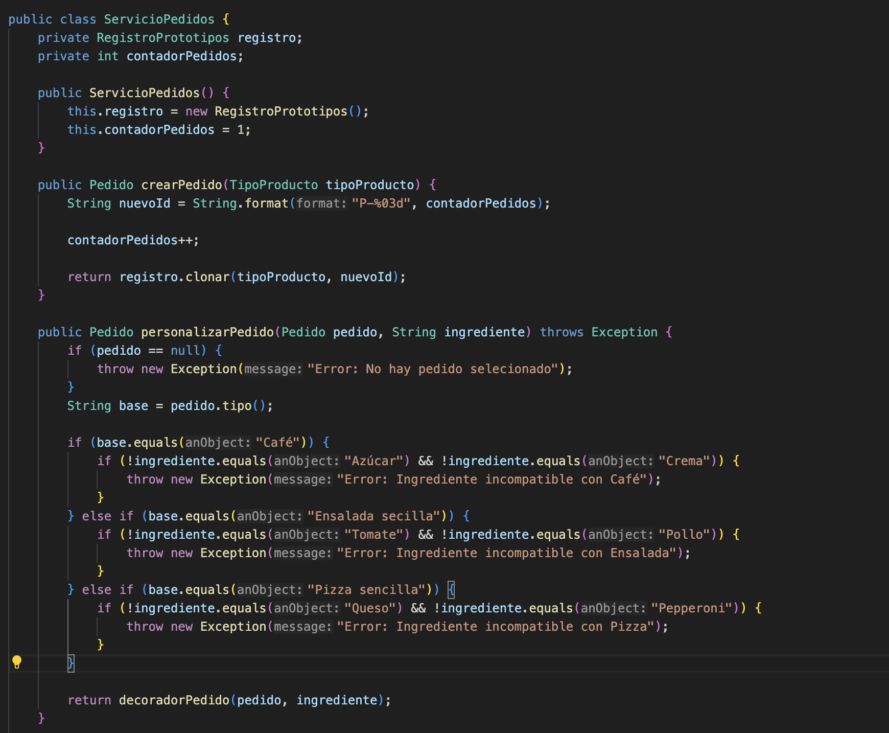
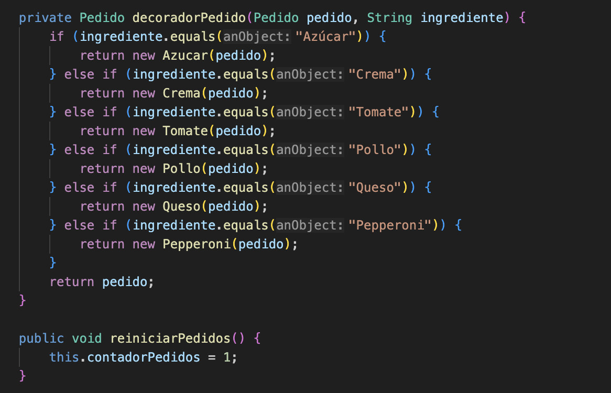

# Evidencias APP1 — PedidoLab

**Repositorio:** https://github.com/bryanstalin2031-lgtm/icc-pap-pl1-patrones.git

**Integrantes:**  Bryam Stalin Carchi Muzha

**Fecha:** 08 de Noviembre del 2026

| Caso | Entrada | Resultado esperado | Resultado real | Evidencia | Estado |
|---|---|---|---|---|---|
| CA01 |Clonar Café dos veces |IDs diferentes; ambos empiezan en$2.20 |Se instancian correctamente con ID P-001 y P-002|[Ver Captura](../assets/CA01.png)|Aprobado |
| CA02 |Comparar clon y objeto del registro |Referencias distintas; el prototipo conserva su configuración |Comprobe que el clon es independiente ya que es una instancia distinta |[Ver Captura](../assets/CA02.png) |Aprobado |
| CA03 |Al primer Café agregar Azúcar y Crema |Descripción incluye los dos ingredientes; total $3.90  |Se uso los decoradores correspondientes sumandole el valor de cada uno dando como total $3.90 |[Ver Captura](../assets/CA03.png) |Aprobado |
| CA04 |Consultar el segundo Café sin ingredientes |Mantiene $2.20, sin ingredientes |No se modifica la descripcion original y matenemos el precio base |[Ver CAptura](../assets/CA04.png) |Aprobado |
| CA05 |Clonar Ensalada y agregar Tomate y Pollo |Total $5.60 |Al clon de la ensalada le agregamos los decoradores Tomate y Pollo. Tendra un costo final de $5.60 |[Ver Captura](../assets/CA05.png) |Aprobado |
| CA06 |Clonar Pizza y agregar Queso y Pepperoni |Total $7.10 |Clonamos pizza y agregamos Queso y Pepperoni con sus decoradores. Precio final de $7.10 |[Ver Captura](../assets/CA06.png) |Aprobado |
| CA07 |Intentar agregar Queso a Café |Operación rechazada; total y descripción no cambian |Controlamos la Excepcion y no permitimos la combinacion y no se modifica la descripción y precio |[Ver Captura](../assets/CA07.png) |Aprobado |
| CA08 |Agregar ingrediente sin pedido selecionado |Mensaje claro y ningún cambio de estado |Controlamos la excepcion y lanzamos un mensaje sobre el error |[Ver Captura](../assets/CA08.png) |Aprobado |
| CA09 |Solicitar clon de clave inexistente |Fallo controlado; no se crea el pedido |Intentamos clonar con null y. manejamos la excepcion y lanzamos el mensaje de que no se crea el pedido |[Ver Captura](../assets/Ca09.png) |Aprobado |
| CA10 |Agregar dos veces Azúcar a un Café |Total $3.20 y dos aplicaiones del decorador |Agregamos dos veces el decorador de Azúcar y sumamso $0.50 dos veces  |[Ver Captura](../assets/CA10.png) |Aprobado |
| CA11 |Reiniciar y volver a clonar Café |Nuevos pedidos parten nuevamente del valor base $2.20|Usamos el metodo de reiniciar y tambien reinicia el contador de pedidios |[Ver Captura](../assets/CA11.png) | Aprobado|

## Identificación de patrones

- **Prototype:** Clase `RegistroPrototipos` en donde tenemos el metodo de clonar, esta clase esta encargada de almacenar los diferentes prototipos y las configuramos para que puedan generar copias de forma independiente.

- **Decorator:** Clase abstracta `DecoradorIngrediente` que con sus clases concretas no permite añadir (ingredientes, descripcion y precio) a objetos de tipo `Pedido`.

- **Integración:** Tenemos el metodo de PersonalizarPedido en la clase `ServivioPedidos`, encargado de fusionar las caracteristicas del Prototype y Decorator.

## Decisiones de diseño

1. Tenenmos la clase RegistroPrototipos para guardar los productos base (Café, Ensalada y Pizza) y los clonamos cada vez que se necesiten objetos de esos tipos, en lugar de crear objetos nuevos con new. Esto nos ayudó a mantener los originales sin modificaciones y a asegurarnos de que cada pedido nuevo tenga una referencia independiente en memoria.

2. Realizamos la aplicacion del patrón Decorator con BigDecimal como se pedia en las indicaciones: Para poder personalizar los platos con ingredientes extra y sumar sus precios sin armar una clase por cada combinación posible. Además  use BigDecimal en la lógica de los modelos y servicios para evitar los errores de redondeo de decimales y afectar la ejecucion.

## Conclusiones

1. Usar Prototype y Decorator me resulto en esta practica ya que me ayudaron a hacer una app que cumpla con la exigencias que podrian tener en la vida real. Si mañana me pidieran agregar mas platos o ingredientes el uso de patrones nos ayuda ha hacerlo sin modificar la estructura original.

2. Se hizo un correcto manejo de excepciones lo que nos permitió controlar las excepciones (como cuando alguien intenta pnerle queso a un café) esto no seria logico. Así evitamos que la aplicación se dañe o se detenga y mantenemos todo seguro y estable.

3. Tener una estructura ordenada separando la interfaz (VentanaPedidos), los servicios y los modelos me ayudo demasiado. Gracias a eso pudimos probar cada caso de aceptación sin la necesidad de tener la parte visual.
